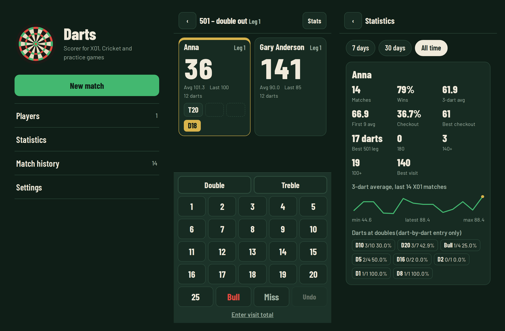

# Darts 🎯

A darts scorer for Android: X01, Cricket and practice games, with a CPU opponent and detailed statistics.
Available in English and Italian. Works fully offline and collects no data.



## Download

**[⬇ Download the latest version (darts.apk)](../../releases/latest/download/darts.apk)** ·
[all releases](../../releases)

Open the downloaded file on your phone and allow installs from that source when Android asks.
Updates install over the previous version and keep your players and match history.

## Features

- **X01** from 101 to 1001: straight, double or master in and out; legs and sets; handicap starts; 2 vs 2 teams
- **Cricket** (standard, cut-throat, no score) and **Killer**
- **Practice**: checkout practice, 121, Catch 40, round the doubles, Bob’s 27, Count Up, target practice, Around the Clock, Halve-It, Shanghai
- **CPU opponent** with 10 skill levels, named after darts champions and simulated on the real board geometry
- **Fast entry**: dart by dart or visit total, hold Miss to end a visit, edit any past visit from the scoresheet, bull-off to decide who starts
- **Checkout suggestions** from the standard chart, updated after every dart
- **Statistics**: averages, checkout % per double, hit map, match charts, head to head, personal bests and achievements
- Rolling scores, reactions to busts, 180s and game shots, synthesised sound effects, caller voice
- English and Italian, light and dark themes, file backup via the Android share sheet, update notice for new releases

### CPU skill levels

Averages measured over 40 simulated 501 double-out matches per level:

| Level | Name | 3-dart average | Checkout |
|---|---|---|---|
| 1 | Eric Bristow | 21 | 6% |
| 2 | John Part | 26 | 8% |
| 3 | Lisa Ashton | 32 | 12% |
| 4 | Raymond van Barneveld | 39 | 22% |
| 5 | Fallon Sherrock | 45 | 20% |
| 6 | Gary Anderson | 54 | 27% |
| 7 | Beau Greaves | 60 | 27% |
| 8 | Michael van Gerwen | 68 | 30% |
| 9 | Luke Littler | 79 | 37% |
| 10 | Phil Taylor | 95 | 40% |

The names are a tribute to the players and only label the difficulty levels; the CPU does not imitate
anyone’s real game. The opponent can be renamed before each match.

## Building

The build runs on GitHub Actions (`.github/workflows/build-apk.yml`):

| Event | Result |
|---|---|
| push to `main` | signed APK attached to the workflow run as an artifact |
| `v*` tag (e.g. `v1.2.0`) | same, plus a GitHub Release with `darts.apk` |

The APK is signed with a key provided through two repository secrets
(*Settings → Secrets and variables → Actions*):

| Secret | Value |
|---|---|
| `ANDROID_KEYSTORE_BASE64` | the PKCS#12 keystore, base64-encoded |
| `ANDROID_KEYSTORE_PASSWORD` | the keystore password |

To create the keystore (Linux, macOS or Git Bash on Windows; the alias must be `darts`):

```bash
read -rsp "Keystore password: " KS_PASS; echo; export KS_PASS
MSYS_NO_PATHCONV=1 openssl req -x509 -newkey rsa:4096 -sha256 -days 10000 -nodes \
  -keyout key.pem -out cert.pem -subj "/CN=Darts"
openssl pkcs12 -export -inkey key.pem -in cert.pem -name darts \
  -out darts-release.p12 -passout env:KS_PASS
base64 -w0 darts-release.p12 > ks.txt   # on macOS: base64 -i darts-release.p12 > ks.txt
rm key.pem cert.pem
```

Keep `darts-release.p12` and its password outside the repository, with a backup:
without the same key, new versions cannot be installed over an existing installation.

To build locally you need Node 22+, JDK 21 and the Android SDK:

```bash
npm ci
npx cap add android
npx capacitor-assets generate --android
npx cap sync android
cd android && ./gradlew assembleDebug
```

The whole app lives in `www/index.html`; after any change run `npx cap sync android`.
Translations are in the `STR` object at the top of the script (`it` and `en`).

## Data and privacy

Players, history and the match in progress stay on the phone (WebView local storage, mirrored to native
Preferences). No network connection is needed. *Settings → Backup* exports and restores everything as JSON.

## License

Code: [MIT](LICENSE). Barlow and Barlow Condensed fonts: [SIL Open Font License](www/fonts/OFL.txt).
